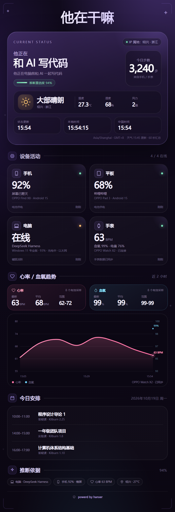

# 他在干嘛 · 我的状态

把 **手机、平板、电脑、手表** 的实时状态汇总成一张暗紫色状态卡，并推断“他现在在干什么”。

在 DeepSeek Harness 里直接输入 **查hanser**，就会调用 `chahanser` 工具，生成并显示一张可保存、可转发的 PNG。

> 想把它搬到腾讯云，让手机/平板在外面也能直接上报：见 [腾讯云部署指南](docs/tencent-cloud.md)。云上部署需要把 `localPc` 设为 `false`，并在 Windows 上运行 PC Agent。



> 上面的预览使用了演示设备数据和示例日程，用来展示完整排版；安装 APK 后会自动替换成你的真实设备数据。`dist/status.png` 始终是最新一次真实状态。

---

## 1. 它是怎么工作的

```
Android 手机 / 平板 ─┐
OPPO Watch ─ BLE ────┤   HTTP POST /api/report        ┌─ 电脑采集器（前台窗口 / 电量 / 键鼠）
                     ├───────────────────────────────► │
Health Connect / 自动化广播 ─┘    本机 Node 服务        └─ 天气 / IP 属地 / 日程
                                                          │
                                                          ▼
                                              规则推断 + HTML 状态卡
                                                          │
                                                          ▼
                                              Chromium 截图 → PNG
                                                          │
                                                          ▼
                                      DSH「查hanser」工具 / 手机浏览器
```

- 所有数据只保存在这台电脑的 `data/` 目录里。
- 手机与电脑需要在同一个 Wi-Fi / 局域网。
- 服务默认监听 `0.0.0.0:17890`，用令牌保护。外网无法直接访问，除非你自己做端口映射。

---

## 2. 三步用起来

### 第一步：启动电脑端服务

```powershell
cd C:\path\to\my-status
.\start.ps1
```

看到 `我的状态服务已启动` 即可。也可以直接：

```powershell
node server/server.js
```

想开机自动启动：

```powershell
.\install-autostart.ps1
# 取消：.\install-autostart.ps1 -Remove
```

### 第二步：给手机 / 平板安装 APK

APK 位置：

```
dist\我的状态.apk
```

安装方式任选：

- 把 APK 发到手机（微信文件传输 / 数据线 / 网盘），点击安装；
- 或电脑连上手机后：

```powershell
adb install -r dist\我的状态.apk
```

打开 App 后填写：

| 字段 | 手机 | 平板 |
|---|---|---|
| 电脑地址 | `http://192.168.1.100:17890` | 同左 |
| 访问令牌 | `CHANGE_ME_TOKEN` | 同左 |
| 设备 ID | `phone` | `tablet` |
| 显示名称 | 手机 | 平板 |
| 设备类型 | 手机 | 平板 |

点 **保存并启动自动上报**，再按顺序授权：

1. **使用情况访问**：读取当前前台 App（不授权也能上报电量，但看不到 App）。
2. **通知 / 活动识别 / 蓝牙权限**：通知用于常驻服务，活动识别用于计步，蓝牙用于直连手表。
3. 如果系统弹出“忽略电池优化”，建议允许，否则后台可能被省电策略杀掉。

> 电脑 IP 变了怎么办？在电脑上运行 `ipconfig`，找到“以太网 / WLAN”的 IPv4 地址，改 App 里的地址即可。令牌在 `config.json` 的 `token` 字段。

### 第三步：在 DSH 里输入“查hanser”

插件已经安装：`@local/xiaotian-status`。

直接发送：

```
查hanser
```

DSH 会调用 `chahanser` 工具，返回推断结果 + 状态卡图片。

如果只是想在手机浏览器里看：

```
http://192.168.1.100:17890/?token=CHANGE_ME_TOKEN
```

页面每 60 秒自动刷新。

---

## 3. 手表数据怎么接

OPPO Watch 的数据路径按优先级有三种：

### A. 标准 BLE 心率 / 血氧（App 内置，自动尝试）

App 会扫描蓝牙名称包含 `OPPO`（可改）或广播了标准 Heart Rate Service 的设备，连接后订阅：

- Heart Rate Service `0x180D` / Measurement `0x2A37`
- Pulse Oximeter Service `0x1822` / Measurement `0x2A5E`
- Battery Service `0x180F` / Level `0x2A19`

如果 OPPO Watch 对第三方 App 开放了这些标准 GATT 服务，就能直接拿到心率、血氧、手表电量。

> 注意：不少 ColorOS Watch 手表在连接 OPPO 健康后不会对外广播标准 GATT。这种情况下 App 会显示扫描不到，继续用下面的 B。

### B. 自动化广播（推荐给不开放 GATT 的手表）

任何能发 Android 广播的自动化 App（MacroDroid、Tasker、自写脚本）都可以推送：

```bash
adb shell am broadcast \
  -a com.kayi.xiaotianstatus.HEALTH \
  --es token CHANGE_ME_TOKEN \
  --ei hr 72 --ei spo2 98 --ei battery 76
```

收到广播后，App 会更新手表卡片并立即上报。`battery` 可省略。

### C. HTTP 直推

如果自动化工具能发 HTTP 请求，直接 POST：

```http
POST http://192.168.1.100:17890/api/report/health
x-xt-token: CHANGE_ME_TOKEN
Content-Type: application/json

{"hr":72,"spo2":98,"battery":76,"source":"OPPO Health"}
```

这条路径完全不经过手机 App，适合用 Tasker / MacroDroid / 快捷指令读取 OPPO 健康通知后转发；`battery` 可省略。收到后会自动生成/更新手表卡片。

电脑上也可以直接用脚本测试或手动补数据：

```powershell
.\scripts\push-health.ps1 -Hr 72 -Spo2 98 -Battery 76
```

MacroDroid 的做法：

1. 新建宏，触发选“定时器 / 间隔”或“收到通知”（选择 OPPO 健康）。
2. 动作选 **HTTP Request / Web Request**。
3. Method 选 `POST`。
4. URL 填 `http://192.168.1.100:17890/api/report/health`。
5. Header 加 `x-xt-token: CHANGE_ME_TOKEN`，Content-Type 用 `application/json`。
6. Body 填 `{"hr":72,"spo2":98,"battery":76,"source":"OPPO Watch"}`，其中数值可以换成 MacroDroid 变量。

> 目前没有公开的 OPPO Health 云端 API。HTTP 推送只负责“把数据送进状态服务”，数据本身仍需从 OPPO 健康通知、Health Connect 或 BLE 读取；如果 OPPO 健康支持把数据写入 Health Connect，再用支持 Health Connect 的自动化 App 转发即可。

### D. ADB 读取 OPPO 健康（当前 OPPO Watch 4 Pro 可用）

OPPO Watch 4 Pro 在 `dumpsys bluetooth_manager` 里是经典蓝牙 HEADSET/SPP 连接，不对外广播标准 BLE 心率服务，所以 App 的 BLE 扫描连不上它。可以借用 USB ADB 读取 OPPO 健康首页：

```powershell
# 手机解锁、USB 调试已授权、OPPO 健康已登录并连着手表
.\scripts\sync-oppo-health.ps1
```

脚本会：

1. 打开 OPPO 健康；
2. 切到“健康”页，读取心率、血氧、步数；
3. 切到“设备”页，读取手表电量和型号；
4. POST 到 `/api/report/health`。

限制：需要手机保持 ADB 连接且解锁；每次同步会短暂切到 OPPO 健康，不是后台无感同步。

### E. 手表端 APK（实验）

OPPO Watch 4 Pro（OWW221，Android 11）可以通过 ADB 安装同一个 APK。安装后会自动识别为手表：

- 通过手表的蓝牙网络代理直接 POST 到电脑
- 上报手表电量、在线状态、步数
- 心率/血氧**不能**由第三方 App 直接读取：即使 `BODY_SENSORS` 显示已授权，SensorService 仍然拒绝
- OPPO 的 `HealthKitProvider` 存在，`CHECK_AVAILABLE=true`、`CHECK_VERSION=2`，也能拉起心率/血氧授权页
- 但 `READ_RECORDS` 会执行 `checkByWhiteList`：内置了 `包名 -> 签名 SHA-256` 白名单，第三方签名不在表里，授权后仍然返回 `authorized failed`
- 因此手表端只能上报电量/在线/网络状态，不能直接读心率/血氧；除非拿到 OPPO HealthKit 的合作签名白名单

因此目前采用混合方案：

```text
手表 APK  → 电量 / 在线 / 网络状态
手机 ADB  → OPPO 健康里的心率 / 血氧 / 步数
```

也可以走 Wi-Fi 无线 ADB，不需要插线：

```powershell
adb tcpip 5555
adb connect 192.168.1.101:5555
.\scripts\sync-oppo-health.ps1 -Serial 192.168.1.101:5555
```

手机重启或切换 Wi-Fi 后，重新执行 `adb connect`。不用时可以用 `adb usb` 关闭 TCP 调试端口。

---

## 4. DSH 插件

插件目录：`plugin/`

- 工具名：`chahanser`
- 触发：系统提示词里的 `<hanser-status>` 段，检测“查hanser / 查一下hanser / hanser在干嘛”
- 输出：一段推断摘要 + 一张已经保存为 DSH attachment 的 PNG

插件配置在 `plugin/cordis.patch.yml`：

```yaml
serverUrl: http://127.0.0.1:17890
token: CHANGE_ME_TOKEN
autoStart: true
serverScript: C:/Users/.../my-status/server/server.js
```

`autoStart: true` 表示 DSH 发现服务没启动时会自动拉起 Node 服务。

重新安装插件（修改插件代码后）：

```
plugin_manager install_bundle
target: C:\path\to\my-status\plugin
```

---

## 5. 电脑端状态

每次生成状态卡时，`scripts/collect-pc.ps1` 会读取：

- 前台窗口标题 / 进程名（VS Code、Edge、游戏、Office…）
- 键鼠空闲秒数
- 电池电量 / 是否充电 / 是否插电
- CPU、内存、开机时长、网卡、本机 IP
- 是否锁屏

如果前台是 DSH，会推断为“和 AI 写代码”；如果是浏览器视频页，会推断为“看视频”。

---

## 6. 日程

`config.json` 的 `schedule` 是数组，例如：

```json
[
  {
    "day": 1,
    "start": "10:00",
    "end": "11:00",
    "title": "程序设计导论 1",
    "type": "答疑课",
    "location": "Kilburn 2.25"
  },
  {
    "days": [2, 4],
    "start": "14:00",
    "end": "15:00",
    "title": "一年级团队项目",
    "type": "实验课",
    "location": "Kilburn 1.8"
  }
]
```

- `day`: 1=周一 … 7=周日；也可以写 `days: [1,3,5]`。
- 当前时间落在某节课内，会优先推断为“上课”，置信度 90% 左右。
- 没有日程时显示“今天没有排课或日程 / 自由时间”。

修改 `config.json` 后重启服务。

---

## 7. 常用命令

```powershell
# 启动 / 检查服务
.\start.ps1

# 手动生成一张（真实数据）
node scripts/snapshot.js

# 生成一张演示卡（会写入演示设备数据，正式使用前建议 /api/clear）
node scripts/demo.js

# 只启动服务
node server/server.js
```

开发调试接口：

| 方法 | 路径 | 说明 |
|---|---|---|
| GET | `/healthz` | 健康检查 |
| GET | `/api/status?token=` | 聚合后的 JSON |
| POST | `/api/report?token=` | 手机 / 平板上报 |
| POST | `/api/report/health?token=` | 手表 / 自动化上报 |
| POST | `/api/snapshot?token=` | 生成 PNG |
| GET | `/status.png?token=` | 最新 PNG |
| POST | `/api/demo?token=` | 写入演示设备 |
| POST | `/api/clear?token=` | 清空设备数据 |

> 本机 `127.0.0.1` 访问免令牌；局域网其他设备必须带 `token`。

---

## 8. 隐私与安全

- 服务只监听局域网，所有上报需要令牌。
- `data/state.json` 保存设备状态与最近 24 小时健康采样；`data/health` 只保留 24 小时。
- 图片生成完全在本机 Chromium 里完成，不经过第三方服务。
- 天气使用 Open-Meteo；IP 属地使用 ip-api / ipinfo。只发送公网 IP 请求，不发送设备数据。
- 令牌会出现在 APK 默认值、插件配置和二维码链接里。不要把 `dist/status.png`、`config.json` 或 APK 发给不信任的人。
- 想换令牌：修改 `config.json` 的 `token`，同步改 App 和 `plugin/cordis.patch.yml`，重启服务并重新安装插件。

---

## 9. 目录结构

```
my-status/
├─ server/
│  ├─ server.js              HTTP 服务 + 路由
│  ├─ lib/
│  │  ├─ store.js            设备 / 健康数据存储
│  │  ├─ pc.js               Windows 状态采集
│  │  ├─ infer.js            活动推断规则
│  │  ├─ classify.js         前台应用分类
│  │  ├─ weather.js          IP 属地 + 天气
│  │  ├─ render.js           HTML 状态卡 + 截图
│  │  └─ screenshot.js       Chrome CDP 动态高度截图
│  └─ templates/card.css     卡片视觉样式
├─ scripts/
│  ├─ collect-pc.ps1         Windows 采集脚本
│  ├─ demo.js                演示数据 + 出图
│  └─ snapshot.js            真实数据出图
├─ android/                  Android 设备端源码 + build.ps1
├─ plugin/                   DSH 插件（chahanser 工具）
├─ dist/
│  ├─ 我的状态.apk    手机 / 平板安装包
│  └─ status.png             最新状态卡
├─ config.json              端口、令牌、日程、时区
└─ start.ps1                 启动服务
```

---

## 10. 已知限制

- 电脑端已在当前 Windows 机器上验证；Android APK 已通过编译和签名，但没有连接实体手机做运行时验证。
- OPPO Watch 是否能直连标准 BLE 心率服务，取决于手表固件是否开放 GATT；不开放时用广播 / HTTP 桥接。
- Android 后台常驻受厂商省电策略影响；建议在系统设置里允许“自启动 / 后台运行 / 不优化电池”。
- 平板需要单独装 APK 并把设备 ID 改为 `tablet`，否则会和手机互相覆盖。
- 图片里的位置是 IP 属地（城市级），不是 GPS 精确定位。
- 日程需要手动写进 `config.json`；没有接学校课表系统。
```
